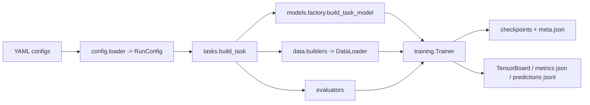
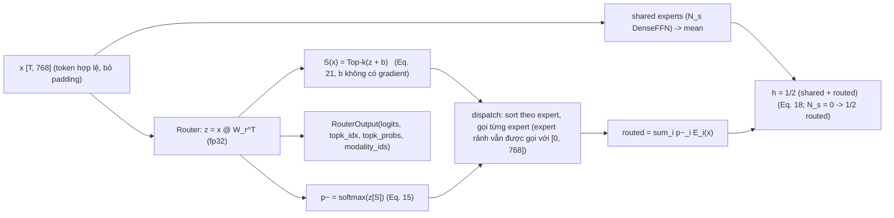

# Kiến trúc và luồng chạy

Tài liệu mô tả code trong `vivlmoe/` bám theo paper *One Tower, Many Experts* (ViVL-MoE): model, loss,
pipeline dữ liệu, vòng lặp huấn luyện, chuỗi checkpoint qua các stage. Lệnh chạy và cách chỉnh nằm ở
`docs/runbook.md`; ánh xạ từng công thức sang code ở `docs/paper_mapping.md`. Đường v2 (C-RADIOv4, mmBERT distill từ
SigLIP 2, sigmoid loss, head Qwen3.5) được mô tả riêng ở `docs/architecture_v2.md`.

## 1. Bố cục package

```
vivlmoe/
├── config/      schema.py (mọi key config = dataclass), loader.py (YAML + _include + override + from_checkpoint), registry.py
├── data/        adapters/ (PhoMT, corpus json/jsonl/HF, KTVIC, UIT-ViIC, ViMACSA, vqa_generic, synthetic)
│                records.py → datasets.py → collators.py → samplers.py / loaders.py; transforms.py, tokenization.py,
│                text_normalize.py, manifest.py, splits.py, image_store.py, builders.py
├── models/      towers/ (VisionTower, TextTower, CLIPTextTeacher), projections.py, resampler.py, attention.py,
│                ffn.py (DenseFFN), block.py (post-LN), encoder.py (12 layer, seam MoE), moe/ (Router, dispatch, MoEFFN, balancing),
│                backbone.py (ViVLBackbone), stage1.py, heads/ (Seq2SeqVLModel, MultiImageClassifier), freezing.py, factory.py
├── losses/      contrastive.py (Eq. 13), teacher.py (Eq. 12), router_losses.py (Eq. 19/20/23/24)
├── upcycling/   key_mapping.py, upcycle.py (Sec. 5.3)
├── analysis/    routing_stats.py (change rate, heatmap, margin)
├── metrics/     bleu, rouge, cider, qa (F1/EM), classification (macro-F1), retrieval (R@K), tokenize
├── training/    distributed.py, ddp.py, optim.py, schedulers.py, amp.py, checkpoint.py, trainer.py, state.py, logging.py
└── tasks/       base.py (Task protocol), stage1_teacher.py, contrastive.py, captioning.py, vqa.py, vimacsa.py,
                 downstream_common.py, evaluators/ (retrieval, teacher_mse, generation, classification, routing, composite, dump)
```

Nguyên tắc chia lớp: **data** chỉ tạo batch dict; **models** chỉ nhận batch và trả dataclass output
(`vivlmoe/models/outputs.py`); **losses** là hàm thuần; **tasks** nối ba thứ đó thành `train_step` và
`evaluators`; **training** chứa một `Trainer` duy nhất, không biết gì về modality hay MoE; mọi collective
DDP đi qua `training/distributed.py`, không bao giờ nằm trong `nn.Module`.



## 2. Model

### 2.1 Backbone (`ViVLBackbone`, paper §4–5.2)

| module (tên attribute = prefix trong state_dict) | lớp | paper config | small / tiny |
|---|---|---|---|
| `vision_encoder` | `VisionTower` (HF `CLIPVisionModel`) | DFN ViT-H/14 @378 → `[B, 730, 1280]` (CLS + 27×27 patch) | ViT-B/32 @224 → `[B, 50, 768]`; tiny → `[B, 5, 32]` |
| `vision_proj` | `Linear(d_v → 768)` = W_v | `[B, 730, 768]` | |
| `resampler` | `PerceiverResampler`: 64 latent query, 2 layer cross-attention (8 head × 64 = inner 512) + FFN 4× | `[B, 64, 768]` | tiny: 8 latent |
| `text_encoder` | `TextTower` (HF XLM-R, không pooler) | XLM-R large → `[B, m, 1024]` | base → `[B, m, 768]` |
| `text_proj` | `Linear(d_t → 768)` = W_t | `[B, m, 768]` | |
| `modality_embed` | `Embedding(2, 768)`; hàng 0 = ảnh (e_v), hàng 1 = chữ (e_t) | | |
| `encoder` | `MultimodalEncoder`: 12 × `TransformerBlock` post-LN (MHSA → Add&LN → FFN → Add&LN), 768/12 head/FFN 3072 GELU, dropout 0.1 | `[B, S, 768]` | tiny: 2 layer, dim 32 |
| `logit_scale` | scalar = log(1/τ), τ init 0.07, clamp ≤ ln 100 | | |

FFN của mỗi block là **pluggable**: `DenseFFN` (fc1 → GELU → Dropout → fc2) khi `model.moe: null`, hoặc
`MoEFFN` khi có `model.moe`. Vì expert cũng là `DenseFFN`, upcycling chỉ là copy state_dict.

### 2.2 Hai chế độ forward

```mermaid
flowchart TB
    subgraph contrastive["mode = contrastive (Stage 2/3, sparse) — hai pass riêng, không cross-attention"]
        I[pixel_values] --> V[vision_encoder] --> Wv[vision_proj] --> R[resampler 64 token] --> Ev["+ e_v"] --> ENC1[encoder] --> P1[mean pool] --> N1["L2 norm -> image_embeds"]
        Tx[input_ids, attention_mask] --> XLMR[text_encoder] --> Wt[text_proj] --> Et["+ e_t"] --> ENC2[encoder] --> P2[masked mean] --> N2["L2 norm -> text_embeds"]
    end
    subgraph joint["mode = joint_* (downstream) — một chuỗi [V~+e_v ; T~+e_t]"]
        I2[ảnh] --> V2["vision_encoder -> vision_proj -> resampler"] --> CAT
        T2[câu hỏi / review] --> X2["text_encoder -> text_proj"] --> CAT[concat + modality ids]
        CAT --> ENC3[encoder] --> H[last_hidden_state]
    end
```



- `contrastive`: `ContrastiveOutput(image_embeds, text_embeds, logit_scale, router_outputs)`; hai pass qua cùng
  `encoder` nhưng độc lập (không leak caption vào embedding ảnh). `router_outputs` gộp cả pass ảnh và pass chữ.
- `encode_image` / `encode_text`: một phía, dùng cho retrieval eval.
- `joint_caption` (chỉ ảnh), `joint_vqa` (ảnh + câu hỏi), `joint_cls` (≤6 ảnh + text theo aspect): trả
  `EncoderOutput`/`Seq2SeqOutput`/`ClassifierOutput` cho head.
- Một lần `forward(batch, mode)` cho mỗi micro-batch (bắt buộc để DDP hoạt động đúng).

### 2.3 Lớp MoE (`models/moe/`, paper §5.3–5.5, Fig. 3)



Router giữ 3 buffer: `expert_bias` (persistent, lưu vào checkpoint), `dispatch_counts` và `token_count`
(không persistent, chỉ cộng dồn khi `training`). **Không** cập nhật bias trong forward.

### 2.4 Head downstream (paper §6.1, Fig. 4)

| head | lớp | luồng |
|---|---|---|
| sinh văn bản (captioning, VQA) | `Seq2SeqVLModel(backbone, bridge, decoder)` | joint pass → `bridge: Linear(768 → d_model 1024)` → `encoder_outputs` của `T5ForConditionalGeneration` (ViT5-large; encoder stack của T5 bị gỡ) → CE với label pad = −100; `generate(batch, num_beams=5, ...)` |
| ViMACSA | `MultiImageClassifier(backbone, cls_head)` | mỗi sample: ≤6 ảnh → resampler mỗi ảnh (chỉ slot hợp lệ) → ghép `[N_img×64 token ảnh ; text "aspect </s></s> review" + tag ảnh]` cho từng aspect (6 chuỗi) → masked mean → `Dropout + Linear(768 → 4)` → loss = tổng theo aspect của CE trung bình batch |

`models/freezing.py` giữ các preset đông lạnh: `stage1` (chỉ text + FC1 train), `stage2`
(`vision_encoder`, `vision_proj` đông), `stage3` (không đông), `sparse` (`vision_encoder`), `downstream_seq2seq`
/ `downstream_cls` (`backbone.vision_encoder`, `backbone.logit_scale`), `downstream_caption` (+ text tower vì
captioning không có token chữ). Sau backward đầu tiên, Trainer kiểm tra mọi tham số trainable đều có gradient
(lỗi cứng → tránh treo DDP).

## 3. Loss

| loss | file | công thức | dùng ở |
|---|---|---|---|
| teacher MSE | `losses/teacher.py` | `mean_i ‖FC1(XLM-R⟨s⟩) − CLIP_text(en)‖²` (Eq. 12; preset `legacy` = normalize + mse) | Stage 1 |
| contrastive | `losses/contrastive.py` | InfoNCE đối xứng (Eq. 13), negative = batch toàn cục (all-gather **có gradient** qua `torch.distributed.nn`), nhãn `arange(B) + rank·B`; `mean` = 0.5×(CE_i2t + CE_t2i) | Stage 2/3, sparse |
| z-loss | `losses/router_losses.py::z_loss` | `mean_t (logsumexp z_t)²` (Eq. 20), λ_z = 1e-3 | mọi run MoE |
| modality-importance | `modality_distributions` + `sym_kl` | P_v, P_t = khối lượng routing (p~, 0 nếu không được chọn) chuẩn hoá theo modality; `L_mi = ½[KL(P_v‖P_t) + KL(P_t‖P_v)]` (Eq. 23–24), λ_mi = 5e-3 | mọi run MoE |
| Switch LB (ablation) | `switch_lb_loss` | `N_r Σ f_i P_i` (Eq. 19) | `switch_lb.yaml` |
| aux-free bias | `models/moe/balancing.py` | không phải loss: `b_i += η·sign(k/N_r − f_i)` (Eq. 22) mỗi optimizer step, `f_i` từ counts đã all-reduce | mọi run MoE |

`RouterLossComputer` gom `RouterOutput` theo `layer_idx` (chế độ contrastive: 2 output/layer — pass ảnh và
pass chữ; chế độ joint: 1 output/layer với modality id trộn), tính loss từng layer rồi **trung bình qua 12
layer**, trả `aux = λ_z L_z + λ_mi L_mi (+ λ_lb L_lb)`. Mọi task cộng `aux` vào loss chính (Eq. 25) — kể cả
downstream.

## 4. Pipeline dữ liệu

```mermaid
flowchart LR
    Y[data.train / data.evals (YAML: kind, root, splits, options)] --> A[Adapter (registry theo kind)]
    A --> R["RecordSet (ImageTextRecord / VQARecord / MultiImageClsRecord / ParallelTextRecord)"]
    R --> HO[holdout theo image_id + exclude ids] --> MF[manifest: kiểm tra ảnh, bỏ ảnh thiếu/hỏng] --> NM[chuẩn hoá tiếng Việt (preset)] --> UID[đánh lại uid 0..N-1]
    UID --> DS[Dataset: mở ảnh (PIL draft) + transform CLIP]
    DS --> CO[Collator: tokenize theo batch (pad longest), tạo dict]
    CO --> DL[DataLoader + sampler]
```

- **Adapter** (`data/adapters/`): mỗi dataset một file, `@register_dataset("kind")`, có dataclass `Options`
  được validate strict. Thêm dataset = 1 adapter + 1 YAML.
- **Record** bất biến, không chứa tensor; corpus 1.1M cặp lưu dạng cột (byte buffer + offset) để worker không
  nhân bản object Python. PhoMT đọc theo byte offset (không `readlines`).
- **Transform** lấy `size/crop/mean/std` từ `CLIPImageProcessor` của đúng vision model (378 cho DFN, 224 cho
  B/32), nên không lệch normalize.
- **Sampler** train: `OneCaptionPerImageDistributedSampler` — mỗi epoch mỗi ảnh xuất hiện đúng một lần với
  một caption ngẫu nhiên (tránh false negative trong InfoNCE), shard đều theo rank, hỗ trợ `set_epoch` và
  `skip_first` (resume giữa epoch). Eval: `OrderedShardSampler` chia `rank::world` **không padding**.
- **Batch dict** theo task:

| task | key |
|---|---|
| stage1 | `en_input_ids [B,77]`, `en_attention_mask`, `vi_input_ids [B,Lv]`, `vi_attention_mask`, `uids` |
| contrastive | `pixel_values [B,3,H,W]`, `input_ids [B,L]`, `attention_mask`, `uids`, `image_ids` |
| retrieval eval | phía ảnh: `pixel_values`, `img_idx`; phía chữ: `input_ids`, `attention_mask`, `cap_idx`, `img_idx` |
| captioning / vqa | `pixel_values`, (`input_ids`, `attention_mask` chỉ VQA), `labels [B,Ld]` (pad = −100) khi train, `refs` khi eval, `prompts`, `uids` |
| vimacsa | `pixel_values [B,6,3,H,W]`, `image_mask [B,6]`, `input_ids [B,6,L]`, `attention_mask`, `labels [B,6]`, `uids` |

## 5. Vòng lặp huấn luyện (`training/trainer.py`)

Thứ tự khởi động (giống nhau trên mọi rank):

```
seed_everything → task.build_model() (CPU) → đông lạnh (preset + optim.freeze) → init_from (nạp strict theo prefix)
→ .to(device) → chính sách dtype cho tower đông lạnh (bf16 trên CUDA) → wrap DDP (broadcast_buffers=False,
find_unused_parameters=False) → seed theo rank → task.build_loaders() → total_steps → param groups → AdamW
→ scheduler cosine theo step (10 % warmup) → AMP → writer → CheckpointManager → resume (nếu có)
```

```mermaid
sequenceDiagram
    participant TR as Trainer
    participant TK as Task
    participant M as DDP(model)
    participant O as Optimizer
    loop mỗi optimizer step
        TR->>TR: zero_grad
        loop accum micro-batch (no_sync trừ batch cuối)
            TR->>TK: train_step(model, batch, ctx)
            TK->>M: forward(batch, mode)  (đúng 1 lần)
            M-->>TK: output dataclass (+ router_outputs)
            TK-->>TR: StepOutput(loss = task + aux, metrics)
            TR->>M: backward(loss / accum)
        end
        TR->>O: unscale, clip_grad_norm, step, scheduler.step (1 lần)
        TR->>TK: post_optimizer_step  (MoE: all-reduce counts -> cập nhật bias Eq. 22 -> reset)
        TR->>TR: log every N step; eval / checkpoint theo cadence; routing probe theo cadence riêng
    end
```

- **Eval**: model unwrapped, `eval()` + `no_grad`; mỗi rank chạy shard của mình, `gather_ordered` gom theo uid
  (assert đủ `0..N-1`), rank 0 tính metric, broadcast dict cho mọi rank → early stopping và `best.pt` nhất quán.
- **Checkpoint** (`training/checkpoint.py`): `step_<N>.pt`, `last.pt`, `best.pt` + sidecar `.meta.json` (config,
  provenance, fingerprint, step, metrics). `tower_provenance` ghi ViT/XLM-R là `hf:<id>` (còn nguyên) hay
  `trained`; tower đông lạnh và còn nguyên không được ghi vào file (nạp lại từ HF khi load). Từ Stage 3 ViT
  thành `trained` và luôn được lưu.
- **Resume** cùng run: fingerprint model phải khớp; khôi phục optimizer/scheduler/scaler/RNG/state task và
  `sampler.skip_first` để tiếp đúng batch. Sang run khác dùng `init_from`.

## 6. Chuỗi stage và cách config kế thừa

```mermaid
flowchart LR
    S1["Stage 1 teacher<br/>train: text_encoder + fc1<br/>loss: MSE (Eq.12)<br/>data: PhoMT"] -->|"init_from load: [text_encoder]"| S2
    S2["Stage 2 contrastive<br/>train: XLM-R, W_t, resampler, f_enc, e_*, tau<br/>frozen: ViT, W_v<br/>data: corpus 1.1M"] -->|"init_from load: [all]"| S3
    S3["Stage 3 end-to-end<br/>train: tất cả (2 lr)<br/>ViT -> provenance trained"] -->|"scripts/upcycle.py"| UP
    UP["upcycled.pt<br/>shared = copy, routed = copy + noise<br/>router random, bias 0"] -->|"from_checkpoint + init_from all"| SP
    SP["sparse training 20K step<br/>frozen: ViT<br/>loss: InfoNCE + z + mi, bias rule"] -->|"from_checkpoint + init_from all<br/>(backbone.* remap)"| DS
    DS["downstream<br/>Seq2SeqVLModel / MultiImageClassifier<br/>stabilizers vẫn bật"]
    S3 -.->|"dense baseline"| DS
```



| stage | config | trainable | đông lạnh | selection |
|---|---|---|---|---|
| 1 | `pretrain/stage1_teacher.yaml` | `text_encoder`, `fc1` | teacher CLIP (ngoài model) | `phomt_dev/mse` ↓ |
| 2 | `pretrain/stage2_contrastive.yaml` | `text_encoder`, `text_proj`, `resampler`, `encoder`, `modality_embed`, `logit_scale` | `vision_encoder`, `vision_proj` | `ktvic_dev/rsum` ↑ |
| 3 | `pretrain/stage3_end2end.yaml` | tất cả (encoders 1e-5, projections 5e-5) | — | `ktvic_dev/rsum` ↑ |
| sparse | `moe/sparse_train.yaml` | tất cả trừ ViT | `vision_encoder` | `ktvic_dev/rsum` ↑ |
| downstream | `downstream/*.yaml` | backbone (trừ ViT, `logit_scale`) + head | ViT (+ text tower khi captioning) | `dev/<metric>` ↑ |

Kế thừa config: file stage `_include` `train_defaults` + `model/paper.yaml` + file data. Từ upcycle trở đi,
file config **không** include `model/*.yaml` mà dùng `model: {from_checkpoint: <ckpt>}` — loader đọc section
`model` từ sidecar của checkpoint (topology MoE, stabilizer) và chỉ cho phép sửa qua `model_overrides`; nếu
`loss.router.use_*` hoặc `moe.aux_free_bias` khác checkpoint thì báo lỗi, trừ khi
`task.allow_stabilizer_override: true` (ablation). Nhờ vậy topology và stabilizer không bao giờ lệch âm thầm
giữa sparse training và downstream.

## 7. Upcycling và phân tích routing

- `upcycling/upcycle.py`: với mỗi key `encoder.layers.{i}.ffn.{fc1,fc2}.{weight,bias}` của dense → copy nguyên
  sang `ffn.shared_experts.{s}.*`, copy + nhiễu `N(0, (0.01·std W)²)` (seed crc32 theo layer/expert/tensor) sang
  `ffn.routed_experts.{e}.*`; `ffn.router.proj.weight ~ N(0, 0.02²)`, `expert_bias = 0`; mọi key khác giữ nguyên.
  Với noise = 0 và N_s ≥ 1, model MoE cho **đúng** output của dense (½(FFN + Σp~·FFN) = FFN) — script kiểm tra
  điều này trước khi lưu.
- `tasks/evaluators/routing.py::RoutingProbeEvaluator` chạy theo cadence riêng của Trainer
  (`analysis.routing_probe`): với tập dev cố định, ghi top-k của từng token, tính **expert change rate** so
  với snapshot trước (cùng token stream, lưu trong checkpoint để resume), **heatmap expert × modality**
  (Eq. 23, trung bình 12 layer) + sym-KL, **router margin** (top-1 − top-2 của softmax(z), không cộng bias).
  Kết quả: `runs/<name>/routing/step_<N>.json` (+ PNG), scalar `dev/routing/*` trong TensorBoard;
  `scripts/analyze_routing.py` chạy offline trên một checkpoint.

## 8. Đánh giá downstream

| evaluator | việc làm | metric |
|---|---|---|
| `RetrievalEvaluator` | encode ảnh và caption riêng, `sim = img @ txt.T`, R@1/5/10 hai chiều, `rsum` | `metrics/retrieval.py` |
| `GenerationEvaluator` | `model.generate` (beam 5) trên từng shard, decode ViT5 tokenizer, gom theo uid, ghi `predictions/<split>_step<N>.jsonl` | BLEU-4 (vendored HF evaluate, tokenizer `13a`), ROUGE-L (`vi_safe` + `rougeL_paper_compat`), CIDEr (pycocoevalcap), F1/EM |
| `ClassificationEvaluator` | argmax theo (sample, aspect), gom theo uid | macro-F1 mỗi aspect trên 4 nhãn (kể cả None) rồi trung bình 6 aspect |
| `TeacherMSEEvaluator` | MSE dev PhoMT | |
| `RoutingProbeEvaluator` | mục 7 | |

Mọi metric + cấu hình tokenizer/generation được ghi vào `metrics/<split>_step<N>.json` để số liệu tái lập được.

## 9. Kiểm thử

| nhóm | nội dung |
|---|---|
| `tests/unit/config` | include/override/strict typing/validate/from_checkpoint |
| `tests/unit/data` | adapter fixture cho mọi kind, PhoMT offset index, manifest, transform khớp `CLIPImageProcessor`, sampler invariants, collator shape |
| `tests/unit/models` | shape resampler/block/backbone, hai pass không leak, tower đông lạnh, head T5/classifier, MoE: router dùng bias chỉ khi chọn, dispatch = vòng lặp naive + gradcheck, **upcycle noise 0 ≡ dense**, mọi expert có gradient, DDP gloo 2 process |
| `tests/unit/losses` | contrastive gather = single process, teacher eq12/legacy, z/mi/lb, contrastive ≡ joint cho L_mi, aux thật sự vào optimizer |
| `tests/unit/training` | scheduler 1 lần/step, param group, checkpoint provenance/exclusion/partial load, resume giữa epoch tái lập batch, early stopping, gloo collectives |
| `tests/unit/tasks` | mỗi task chạy 2 step + 1 eval qua Trainer thật với config tiny |
| `tests/integration` (slow) | chuỗi CLI stage1 → stage2 → stage3 → upcycle → MoE (probe) → downstream → evaluate → analyze_routing, và resume |
| `hf_cache` | model small thật (`models/`) + ảnh KTVIC thật |
