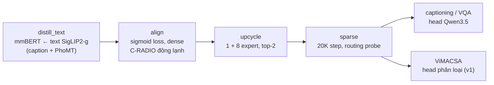

# Kiến trúc v2: backbone hiện đại hoá, giữ MoE one-tower

v2 là đường **bổ sung** chạy song song v1. v1 vẫn tái lập paper và dùng cho ablation, còn v2 thay những phần đã cũ
của backbone và giữ nguyên phần MoE. Mọi field config mới có mặc định giữ hành vi v1, toàn bộ test v1 vẫn pass.
Code v1 được mô tả ở `docs/architecture.md`, lệnh chạy ở `docs/runbook.md` (mục 2.5 và 3.2), còn khác biệt so với paper
ở `docs/paper_mapping.md` (mục "v2").

## 1. Thay gì, giữ gì

| Thành phần | v1 (paper) | v2 | Lý do |
|---|---|---|---|
| Vision tower | DFN CLIP ViT-H/14 @378, mở đông ở Stage 3 | **C-RADIOv4-SO400M** @512, luôn đông lạnh (thay được bằng SigLIP 2 g / So400m) | distill từ SigLIP2-g + DINOv3 + SAM3: vừa có feature gắn ngôn ngữ vừa có feature không gian dày |
| Text tower | XLM-R large (2019) | **mmBERT-base** (ModernBERT, 307M, ngữ cảnh 8K) | encoder đa ngữ mới, nhẹ hơn, học trên 1.800+ ngôn ngữ |
| Bước 1 | Stage 1 M-CLIP: XLM-R khớp text CLIP **tiếng Anh** trên PhoMT | **distill text**: mmBERT khớp text tower **SigLIP2-g** (đa ngữ) trên caption tiếng Việt, PhoMT tuỳ chọn | teacher đọc được tiếng Việt nên học thẳng caption → caption |
| Loss căn chỉnh | InfoNCE, τ = 0.07 | **sigmoid (SigLIP)**, t = 10, b = −10 | không cần softmax toàn batch, ổn định với batch nhỏ mỗi GPU |
| Stage 2 + 3 | 2 stage (ViT + W_v đông lạnh, rồi mở đông toàn bộ) | **một bước align** (vision đông lạnh, W_v train ngay từ đầu) | vision tower mới đã đủ tốt, không cần mở đông |
| MoE | 1 shared + 8 routed, top-2, aux-free bias, z-loss, L_mi, upcycling | **giữ nguyên** (`configs/moe/*`) | vẫn là thiết kế hiện đại |
| Head sinh | ViT5-large (encoder-decoder) | **Qwen3.5-0.8B** (decoder-only), nhận trạng thái joint làm tiền tố | LLM nhỏ đa ngữ, 201 ngôn ngữ, vocab 248K |



## 2. Vision tower (`model.vision.kind`)

`BaseVisionTower` (`vivlmoe/models/towers/vision.py`) chứa phần chung (dtype khi đông lạnh, `train()`, `assert_dims`).
`VisionTower` vẫn là class CLIP của v1. Hai class mới:

- `RadioVisionTower` (`vision_radio.py`, `kind: radio`): load bằng remote code của HF (`trust_remote_code`), ghim
  `vision.revision` (lấy commit mà `fetch_models.py --only v2` in ra). Tower đông lạnh ngay khi dựng và báo lỗi nếu
  bật train. Đầu vào là ảnh trong [0, 1] (RADIO tự chuẩn hoá), resize vuông bicubic 512 → `[B, 1024, 1152]`.
  Provenance là `hf:<id>@<revision>`.
- `SiglipVisionTower` (`vision_siglip.py`, `kind: siglip`): `SiglipVisionModel` không dựng MAP head, không có CLS,
  `last_hidden_state` đã qua post-LN. Ảnh resize vuông bilinear, mean/std 0.5. SigLIP2-g @384 cho 576 token × 1536,
  So400m @384 cho 729 token × 1152.

Tiền xử lý chọn bằng `data.transform.source: tower`. Config báo lỗi nếu tower không phải CLIP mà vẫn để
`clip_processor` (nếu không sẽ âm thầm resize rồi crop sai kích thước).

## 3. Text tower mmBERT

`text.arch: modernbert` chỉ dùng để chọn class khi dựng model tí hon. Model thật load bằng `AutoModel` với
`reference_compile=False` (không có pooler). Trọng số các module được train luôn load ở fp32 (`utils/hf.py::load_fp32`),
vì transformers 5 có thể giữ dtype của checkpoint.

## 4. Bước 1: distill text (`configs/v2/distill_text.yaml`)

Tái dụng task `stage1_teacher`, chỉ đổi teacher qua `model.stage1`:

| Key | v2 | Ý nghĩa |
|---|---|---|
| `teacher_kind` | `siglip` | teacher là `SiglipTextTeacher` (`towers/siglip_teacher.py`) |
| `teacher_name` | `google/siglip2-giant-opt-patch16-384` | repo đầy đủ; tower text và tower ảnh load riêng, không dựng `SiglipModel` |
| `teacher_lowercase` | `true` | SigLIP 2 được train trên chữ thường (chỉ hạ chữ phía teacher) |
| `student_pooling` | `mean` | masked mean các trạng thái mmBERT → `fc1` (v1: token `<s>`) |
| `loss_preset` | `legacy` | MSE giữa hai vector đã chuẩn hoá L2: khớp hướng, đúng thứ không gian joint (cosine) so sánh |
| `data.tokenizer.en_max_len` | `64` | text teacher luôn pad tới 64 token và **không** dùng attention mask, như lúc train SigLIP |

Mọi thứ mô tả teacher (số chiều, tokenizer, tower ảnh, transform của evaluator) đi qua `towers/teachers.py`
(`teacher_output_dim`, `teacher_vision_cfg`) thay vì đọc `model.vision`, vì ở v2 `model.vision` là C-RADIO.

**Dữ liệu.** Train là một `mixture` có tên nguồn:

- `captions`: adapter `caption_text` đọc caption từ `corpus/pretrain_corpus.jsonl`, bỏ trùng, lưu dạng cột nén.
  Mỗi caption vừa là đầu vào teacher vừa là đầu vào student (`src` chính là `tgt`), nên chỉ chuẩn hoá một lần cho cả
  hai phía.
- `phomt`: 2M cặp PhoMT (teacher đọc tiếng Anh, student đọc tiếng Việt). Bỏ bằng `data.train.options.sources.phomt=null`
  (hoặc `DISTILL_PHOMT=0` khi chạy `run_pretrain.sh`).

Hai nguồn được nối bằng `ConcatRecordSet`: uid toàn cục, `select` lười (PhoMT vẫn đọc theo offset), `map_text` áp cho
từng phần.

**Đánh giá.** Dev chính là R@K trên KTVIC / UIT-ViIC dev trong không gian joint của SigLIP 2: caption tiếng Việt qua
student, ảnh qua tower ảnh của teacher với đúng tiền xử lý của nó. Checkpoint được chọn theo `ktvic_dev/rsum`.
Khoảng cách tới teacher trên PhoMT dev chỉ được ghi log.

## 5. Bước 2: align, sigmoid loss (`configs/v2/align.yaml`)

`model.contrastive_head: sigmoid` làm backbone tạo thêm tham số `logit_bias` (state-dict v1 không đổi) và task
`contrastive` dùng `SigmoidContrastiveLoss` (`losses/contrastive.py`):

```
L = -(1 / B_local) * sum_i sum_j log sigmoid( z_ij * (t * <x_i, y_j> + b) ),   z_ij = +1 nếu i == j, -1 nếu khác
```

Chỉ text được all-gather (có gradient). Mỗi rank tính ảnh cục bộ × text toàn cục rồi chia cho `B_local`, và trung
bình gradient của DDP cho đúng gradient của loss toàn cục (test gloo 2 tiến trình kiểm chứng điều này).

- Preset `sparse`: chỉ đông lạnh vision tower, nên W_v, resampler, f_enc, W_t và mmBERT đều được train.
- Hai learning rate: `text_encoder` 3e-5 (đã distill), phần còn lại 1e-4.
- Text tower lấy từ bước distill (`init_from: {load: [text_encoder]}`).
- Config được chỉnh cho 1 A40: 256 × accum 2 = 512 mẫu mỗi bước tối ưu. Mỗi step chấm 256 ảnh với 256 text;
  có nhiều GPU thì text được all-gather (256 × số GPU).
- Ở downstream, `logit_bias` tự được đông lạnh như `logit_scale`.

## 6. Bước 3–4: upcycle và sparse

Không đổi so với v1. `configs/v2/upcycle.yaml` và `configs/v2/sparse.yaml` include `configs/moe/*` và chỉ đổi đường
dẫn checkpoint, tên run (`runs/v2_*`, không đụng run v1) và `transform.source`. Loss sigmoid, C-RADIO và mmBERT đi
theo phần `model` thừa kế từ checkpoint.

Ngân sách sparse được cắt cho 1 A40: 6.000 step × 512 ≈ 3,1 triệu mẫu (khoảng 8 epoch của 378K ảnh). Ngân sách
của paper (20K step × 2048 ≈ 41 triệu mẫu) sẽ mất khoảng 10 ngày trên một GPU.

## 7. Head LLM (`model.generation.kind: causal_lm`)

Không thêm model kind mới: `build_task_model("seq2seq", cfg)` trả `CausalLMVLModel` (`models/heads/causal_lm.py`) khi
`generation.kind` là `causal_lm`. Task caption/VQA giữ `model_kind="seq2seq"` và chỉ đổi collator.

**Bố cục chuỗi.** Mỗi mẫu là một chuỗi gọn:

```
[ trạng thái joint hợp lệ (64 latent, + token câu hỏi hợp lệ với VQA) ; prompt ; đáp án + EOS ]
```

- Trạng thái joint đi qua `projector` (`mlp2` kiểu LLaVA-1.5 hoặc `linear`) sang chiều embedding của LLM.
- Prompt là `task.llm_prompt_template` (VQA được dùng `{question}`) và chiếm tối đa `task.llm_max_prompt_len` token.
- Cả batch được **pad bên trái**, với `position_ids = cumsum(mask) − 1`. Các lớp Gated DeltaNet (attention tuyến tính)
  của Qwen3.5 đưa vị trí pad về 0, nên chỉ chính xác khi pad nằm ở đầu chuỗi, không có lỗ ở giữa. HF `generate` cũng tự
  suy ra đúng các vị trí này từ attention mask, nên lúc train và lúc sinh mô hình thấy đầu vào giống hệt nhau.
- Labels dựng trong model. `lm_head` chỉ chạy ở các vị trí dự đoán token đáp án, vì vocab 248K sẽ chiếm hết bộ nhớ nếu
  chạy trên cả chuỗi. Model không trả logits.
- Batch không có `labels` (lúc eval) chỉ chạy phần joint, nên routing probe dùng được như với ViT5.

**Collator.** `CausalLMCollator` kế thừa `Seq2SeqCollator`:

- Giữ `input_ids` / `attention_mask` của câu hỏi cho backbone.
- Thêm `llm_input_ids` / `llm_attention_mask` cho prompt.
- `labels` là token đáp án + EOS của tokenizer LLM, pad bằng −100.

Evaluator truyền `eos_token_id` / `pad_token_id` của tokenizer LLM cho `generate`.

**Load LLM.** `heads/llm_loader.py::load_causal_lm` dùng đúng class `Qwen3_5ForCausalLM`. Lý do:
`AutoModelForCausalLM` âm thầm khởi tạo lại phần ngôn ngữ của checkpoint composite (transformers#49324). Hàm này báo
lỗi nếu thiếu bất kỳ trọng số nào và trả về fp32.

**Downstream** (`configs/v2/downstream/*`): mỗi file include file v1 cùng tên (dữ liệu, metric, split giữ nguyên) rồi
thêm `_llm_head.yaml`:

- learning rate: LLM 2e-5, projector 1e-4, backbone 3e-5;
- `keep_last_n: 1`, vì mỗi checkpoint nặng vài GB.

ViMACSA giữ head phân loại của v1 trên backbone v2.

## 8. Kiểm chứng

| Ở đâu | Kiểm gì |
|---|---|
| Mac, `make test` | test v1 nguyên vẹn, cộng các test v2 sau: tower, transform, sigmoid loss (gồm gloo), teacher SigLIP, pooling, `caption_text` / `ConcatRecordSet` / mixture có tên, head LLM trên Qwen3-Next tí hon (loss của batch pad trái == loss từng mẫu không pad; sinh theo batch, beam 1 và 2, == sinh từng mẫu; MoE + routing probe), config v2 thật load được và nhóm learning rate phủ đúng module |
| Mac, `make test-all` | `tests/integration/test_cli_smoke_v2.py`: distill → align → upcycle → sparse → caption với head LLM → `evaluate.py`, mỗi bước là một tiến trình `scripts/*.py` |
| Máy GPU (runbook 2.5) | `probe_vision.py` (truy xuất zero-shot để chọn vision encoder và đo teacher đọc tiếng Việt), `check_llm_head.py` (Qwen3.5 load đủ trọng số, perplexity, gradient, sinh theo batch), `PREFLIGHT=1 PIPELINE=v2 bash scripts/run_pretrain.sh` |

## 9. Việc còn mở, ngoài phạm vi

- Ghim `model.vision.revision` của C-RADIO trong `configs/model/v2.yaml` sau lần `fetch_models.py --only v2` đầu
  tiên (code remote chạy với `trust_remote_code`).
- ViMACSA nối khía cạnh và review bằng sep token của tokenizer text. Cần xem sep của mmBERT một lần trên máy GPU.
- Chưa làm: cache feature cho vision đông lạnh, LoRA cho LLM, NaFlex của SigLIP 2.
